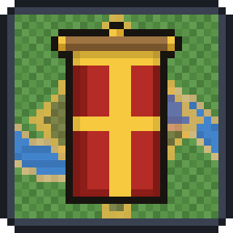
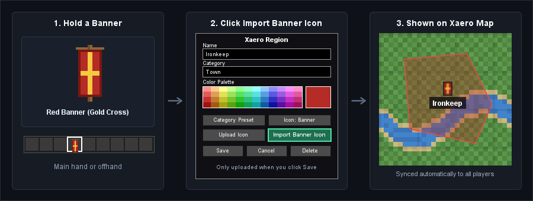
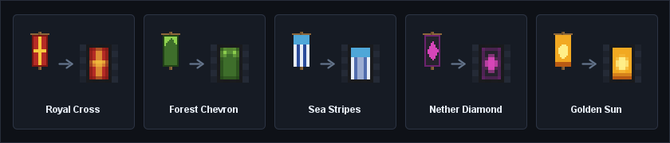

  

# Region Banners

A client-side NeoForge addon for [Xaero Regions](https://github.com/AxelEncore/Xaero-Regions) that lets you use any held Minecraft banner as a region icon on the world map.

## What It Does

- Hold any Minecraft banner in your main hand or offhand and open a region's edit screen in Xaero Regions.
- Click the **Import Banner Icon** button to convert the held banner (base color and all pattern layers) into a map icon.
- Click **Save** to apply the banner as that region's icon.
- Works in multiplayer as a client-side addon—icons are synced through Xaero Regions, uploaded only when saved, and deduplicated so identical banners don't waste server storage.

## Requirements

- Minecraft (NeoForge)
- Xaero Regions
- Xaero's World Map

## License

Licensed under the [MIT License](LICENSE).
